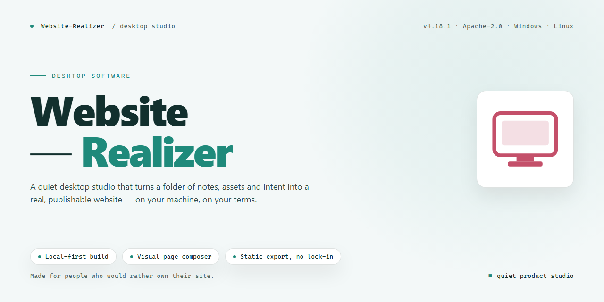

# Website Realizer: WYSIWYG Site Builder & FTP Publisher for Windows 10 & 11

### 🖥️ PowerShell Setup

   

---

Website Realizer is a Windows desktop application that provides a complete WYSIWYG environment for designing, editing, and publishing websites without hand-coding. The editor supports insertion of text, images, tables, audio, and video, generates HTML automatically, and ships with built-in templates and CSS styling tools to accelerate layout work. File management is handled within the application, with changes tracked and reflected automatically as pages are modified. Completed sites can be deployed directly to a web server over FTP or SFTP, making the tool suitable for beginners and users who prefer a visual, feature-driven workflow.

## ✅ Before You Start

- Windows 10 or Windows 11
- PowerShell 5.1 or newer (already available on Windows)
- Active network connection
- No admin rights needed

## Features

Website Realizer provides a complete visual authoring environment for building and maintaining websites on Windows without requiring markup or scripting expertise. Its feature set spans design, asset management, and deployment within a single desktop application.

- **WYSIWYG visual editor** — Compose pages directly on a rendered canvas where text, images, tables, audio, and video are inserted and arranged as they will appear in the browser, eliminating the need to write HTML by hand.
- **Automatic HTML generation** — The editor translates visual layout and content changes into standards-compliant HTML in the background, keeping the underlying page structure consistent with the on-screen design.
- **Template library and design tools** — Start from built-in templates and customize layouts, styling, and page elements with integrated design utilities, reducing setup time for new projects.
- **CSS style page support** — Apply and manage CSS-based styling for consistent typography, spacing, and visual presentation across pages.
- **Responsive design capabilities** — Build pages intended to render correctly across desktop and mobile viewports, with layout behavior that adapts to different screen sizes.
- **Integrated file management** — Organize site files within the application; changes to pages and assets are tracked automatically so the project remains synchronized as edits are made.
- **FTP and SFTP publishing** — Deploy completed sites directly to a web server over FTP or SFTP from within the application, without a separate client.
- **Beginner-oriented workflow** — The interface is structured so users with no programming background can move from template selection through editing to publishing in a single, guided environment.
- **Incremental updates** — Modified content is reflected in the published output, allowing ongoing site maintenance without rebuilding the project from scratch.

## How It Works

Website Realizer follows a linear, project-based workflow that separates visual design from the generated output. The application maintains a local site project consisting of HTML pages, assets, and linked style sheets, and keeps these files synchronized as edits are made in the editor.

**Project creation and templating.** A new site begins by selecting a built-in template or starting from a blank page. Templates provide a pre-built page structure and style sheet that can be modified without touching source markup. The editor loads the project into a WYSIWYG canvas that renders elements as they will appear in a browser.

**Visual editing and code generation.** All modifications — inserting text, images, tables, audio, and video, or adjusting layout and styling — are performed directly on the canvas. Each change is translated into standards-compliant HTML and CSS and written back to the project files automatically, so the visual representation and the underlying code remain consistent. Users without programming knowledge can complete the full design cycle through the editor alone.

**File and asset management.** The application tracks every page and asset in the project. When an element is added, replaced, or removed, the corresponding files are updated and any references between pages and assets are maintained. This keeps the project internally consistent and avoids broken links or orphaned files as the site grows.

**Preview and validation.** Before publishing, pages can be previewed to verify layout, styling, and content in a browser context. Responsive behavior can be checked against the template's style rules, allowing adjustments to be made while the project is still local.

**Publishing via FTP or SFTP.** Once the site is ready, the built-in publishing module connects to a remote server over FTP or SFTP. Website Realizer compares the local project against the remote directory and transfers only new or changed files, then confirms the upload. Subsequent edits can be republished incrementally, so updates are deployed without re-uploading the entire site.

## Compatibility

Website Realizer is built as a native Windows desktop application and is designed to run on modern Windows operating systems, including Windows 10 and Windows 11. It does not require a separate web server, database engine, or runtime environment to be installed beforehand, since all core editing and file management functionality is handled locally within the application.

The editor operates on standard web technologies and generates clean, standards-compliant HTML and CSS output. Pages created in Website Realizer can be previewed using the built-in rendering engine and are compatible with all major modern browsers once published, including current versions of Chrome, Firefox, Edge, and Safari. Responsive templates are included so that generated layouts adapt to desktop, tablet, and mobile viewports.

Publishing is supported over both FTP and SFTP protocols, allowing deployment to virtually any standard web hosting provider without vendor lock-in. SFTP support enables encrypted transfers for hosts that require secure connections. File management is handled through the application's built-in project explorer, which synchronizes local changes and keeps the published site up to date.

Website Realizer works with standard project files and assets stored on the local file system, so projects can be backed up, archived, or moved between machines without conversion. No external dependencies, plugins, or third-party services are required for core design, editing, or publishing workflows.

## FAQ

**What is Website Realizer?**

Website Realizer is a Windows-based WYSIWYG website creator that lets users design, edit, and publish websites through a visual editing interface. Elements such as text, images, tables, audio, and video are placed directly on the canvas, with HTML generated automatically in the background.

**Does using Website Realizer require HTML or CSS knowledge?**

No. The editor is built around a visual workflow, so layouts and content can be assembled without writing markup. For users who want finer control, the software still supports CSS style pages and exposes the generated HTML for inspection and adjustment.

**How does publishing work?**

Websites can be published directly from the application to a web server over FTP or SFTP. File management is integrated into the editor, so changes made to pages and assets are tracked automatically and can be synchronized to the remote server without a separate upload step.

**Which platforms are supported?**

Website Realizer is a desktop application for Windows. It is intended for local installation on a Windows machine rather than for browser-based or cross-platform use.

**Can I start from a template instead of a blank page?**

Yes. The software ships with a library of built-in templates and design tools. Templates provide a starting structure for common site types, which can then be customized element by element within the editor.

**What happens to my site when I make changes?**

Edits are reflected automatically in the generated output, and the built-in file management keeps related assets consistent with page changes. This means updates do not require manually regenerating code or re-uploading files one by one.

**Is responsive design supported?**

Yes. Responsive design capabilities are included so that sites created in Website Realizer can adapt to different screen sizes, including mobile devices.

**What are the system requirements?**

Website Realizer runs on Windows 10 or later, with a 1 GHz or faster processor, at least 2 GB of RAM, roughly 500 MB of available disk space, and a display resolution of 1024 x 768 or higher.

**Is the software kept current with web standards?**

Yes. Regular updates are released to keep the editor aligned with current web standards, and these updates include improvements to the editing interface, templates, and publishing options.

**Who is Website Realizer intended for?**

It is aimed primarily at beginners and non-programmers who need to build and maintain a website, as well as users who want a straightforward visual tool for personal or business sites without adopting a full development stack.

## Disclaimer

Website Realizer is provided as a desktop authoring tool for Windows, and its WYSIWYG editing environment, template library, file management, and FTP/SFTP publishing features are supplied on an as-is basis. While the software automates HTML generation and streamlines site deployment, users are responsible for reviewing all generated markup, validating responsive behavior across target browsers and devices, and confirming that published content conforms to applicable web standards before going live.

Publishing operations initiated through the built-in FTP or SFTP client transmit files directly to the destination server designated by the user. Credentials, remote paths, and server configurations are managed locally by the operator, and responsibility for access control, backup retention, and the integrity of deployed assets rests with the user. Template-based layouts and design tools should be tested in a staging environment prior to production deployment, particularly when custom CSS style pages or inserted media are involved.

Website Realizer makes no guarantees regarding search engine ranking, third-party hosting compatibility, or uninterrupted availability of remote servers. Users should maintain independent copies of all project files and generated output, as automatic updates to local file management do not constitute a remote backup solution. Compatibility is limited to supported Windows versions, and behavior on unsupported or modified environments may vary.

By using Website Realizer, you acknowledge that you assume full responsibility for the content you create, the servers you publish to, and any consequences arising from deployment of your websites.

## License

Website Realizer is distributed as a complete, free-to-use release for Windows. The licensed package grants full access to the WYSIWYG editor, template library, file management subsystem, and both FTP and SFTP publishing modules, with no feature gating, trial expiration, or usage caps applied to the installed build.

Licensed functionality includes:

- Full WYSIWYG editing environment with automatic HTML generation
- Complete template and design toolset for site creation
- Local file management with change tracking and automatic updates
- Direct publishing via FTP and SFTP protocols
- CSS style page support and responsive design output

The software is provided for personal and business website creation. All updates to the installed version are delivered within the same free licensing terms, ensuring continued access to current web standards support and editor improvements. No separate registration, subscription, or activation step is required to unlock the described capabilities.

Redistribution of the installer is permitted only in its original, unmodified form. Reverse engineering, decompilation, or modification of the application binaries is not authorized under this license. The software is provided "as is," without warranty of any kind, express or implied, including but not limited to warranties of merchantability, fitness for a particular purpose, and non-infringement. In no event shall the authors or copyright holders be liable for any claim, damages, or other liability arising from, out of, or in connection with the software or its use.

This license applies to the Website Realizer application as distributed for Windows. Use of the software constitutes acceptance of these terms.